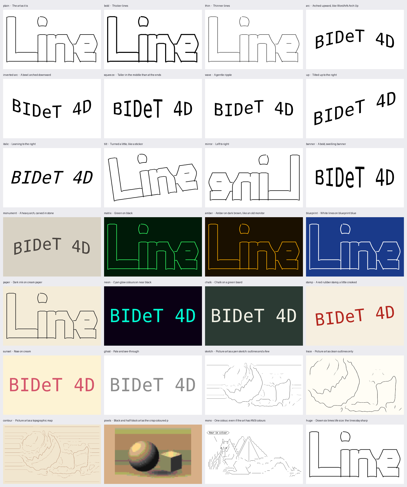

# BIDeT 4D

Re-architecture of BIDeT3D / unascii into three tools that talk through one file format, and `bidet`, the one
command that most people will use.
Status: 2026-10-12. The format (`BIF-SPEC.md`), `bif.py`, `bifin` (terminal art, text in a font, terminal sessions),
`bifop` (shapes, colour, 3D, animation, joining), `bifout` (PNG, GIF, SIXEL, live playback) and `bidet` with 50 presets
exist and are tested; the gallery below shows them. **Setting it up: [`INSTALL.md`](INSTALL.md).** Pipelines with other people's tools (fortune, figlet, cowsay, ffmpeg, git ...):
[`RECIPES.md`](RECIPES.md). Changing the code:
[`DEVNOTES.txt`](DEVNOTES.txt). The running state of the work: [`HANDOFF.md`](HANDOFF.md). Where it comes from:
[`../HISTORY.md`](../HISTORY.md); licence and warranty: [`../LICENSE`](../LICENSE), [`../WARRANTY`](../WARRANTY).
Man pages: `bidet(1)`, `bifin(1)`, `bifop(1)`, `bifout(1)`. `../3D` (BIDeT3D, with `3D/unascii` and `3D/gfx-conv`) is **legacy**:
it gets no new features or fixes. 4D does not depend on it: the parity tests use a frozen copy of unascii
(`tests/reference/`) and 4D's own `samples/`; only an optional SIXEL decoder test looks in `3D/gfx-conv`.

## Two ways to use it

1. **Pipe the tools** (power users): `in | op | out` with every flag of each tool.

       bifin cow.txt | bifout -s                     # the whole pipeline, SIXEL on the terminal
       bifin art.ans -o art.bif && bifout art.bif -o art.png --scale 3 --ink "#00ff66" --paper "#101820"
       bifin figlet.txt | bifop wave:amplitude=0.1 pen:1.5 crop:margin=8 | bifout -o wordart.png --scale 2

2. **`bidet`** (everyone else, and the replacement for bidet3d): one command, a few options, named presets,
   and it works out the rest (text or file or pipe, SIXEL or PNG, the size, a dark terminal).

       bidet "Hello, World!"                          # text, on the terminal
       bidet cow.txt -P arc -P matrix                 # art, arched, green on black
       cowsay moo | bidet -P bold -o moo.png
       bidet --list-presets
       bidet -n cow.txt -P arc -P matrix              # prints the pipeline it would run: a way in to mode 1

   `bidet` is sugar over the pipeline, not a second implementation: the picture it draws is byte for byte what the
   `bifin | bifop | bifout` pipeline it prints draws (a test checks that), and presets are recipes of those tools'
   flags in [`presets.ini`](presets.ini), which anyone can extend in `~/.config/bidet/presets.ini`. At present it
   draws text, set in any installed TrueType font (`bidet -F impact "Sale"`, `bidet --list-fonts`), and art, in the
   shapes, colours, 3D solids and animations BIF and the 3D stage have (textures and tiles come with paint kinds).
   The presets are a tour of what 4D does,
   each drawn on an input that suits it (`make gallery` redraws this):

   

   (The pictures and animations in `gallery/` are not part of `main`: they are the **`media` branch**, mounted here as a
   git worktree, and it holds only the latest of them, as one commit that `make media` replaces, so the repository does not
   grow with every redraw. `make publish-media` sends it to GitHub, if you want it there; in a fresh clone,
   `git fetch origin media && make media-checkout`. The links in this file are relative, so they show wherever
   `gallery/` is mounted; on GitHub they need the branch merged or the links changed to `raw.githubusercontent.com/.../media/...`.)

   Warps and weights (`arc`, `squeeze`, `wave`, `up`, `italic`, `banner`, `bold`, `thin`), colours (`matrix`,
   `amber`, `blueprint`, `neon`, `chalk`, `stamp`, ...), transforms (`tilt`, `mirror`, `huge`: six times life size
   and still sharp), and the picture-art tracers: `sketch`, `trace` and `contour` turn shaded ASCII into vector
   outlines and contour lines, and `pixels` keeps block art exact.

   **3D and 4D.** Looks (`chrome`, `rainbow`, `gold`, `superhero`, `dusk`, `lagoon`, `cobalt`, `graphite`, `brick`, `horizon`,
   `lime`, and `relief`, which extrudes line art) are lit, extruded solids on a shadow; motions (`popout`: 2D to 3D, it
   pops out of the screen; `turntable`; `swing`; `rise`) make them move (a GIF, or live on a SIXEL terminal); and
   they combine with each other and with the shapes, the later one winning:
   `bidet -P arc -P popout -P chrome "Hello" -o hello.gif` is a chrome arch that pops out of the screen.
   Showpieces are made of others (`marquee`, `bubble`, `ripple`, `skyline`, `reveal`, `carnival`). A preset says
   `solid = material=gold depth=0.16 tall=1.2`, `motion = pop+hold+spin hold=2.4`, or `uses = arc gold`
   (see the top of `presets.ini`). `python gallery.py --gif` draws every 3D preset together, the moving ones moving:

   

   And one of them alone, `bidet -P popout "BIDeT 4D" -o popout.gif`:

   

   **Scrolling text.** `bidet --scroll "Hello, World"` slides the text through a window, round and round (a looping GIF, or live
   until Ctrl-C on a SIXEL terminal): the marquee of the CP/M "LARGE letter" program (CWP!inc, 1994), which every
   BIDeT has to have. `--scroll up` is rolling credits, `--window` says how much shows, `--speed` how fast; the presets
   `ticker`, `cpm` (the original: white letters entering from the right edge) and `credits` set them up, and a 3D look scrolls
   too (`bidet -P gold --scroll "GOLD RUSH" -o gold.gif`). It is one `bifop` operation, `scroll`, which takes any flat
   picture: `bifin -f lettering Hello | bifop crop:margin=10 scroll:left,start=enter | bifout -o hello.gif`.

   **Recipes.** `bidet` reads a pipe, so anything that prints is an ingredient: `fortune -s | bidet --scroll`, `git describe
   --always --dirty | bidet -t -P gold`, `figlet -f big Hi | bidet -P sunset`, a `.vt` replayed as a GIF, a GIF repacked as MP4 or laid
   along the bottom of a video by `ffmpeg`. [`RECIPES.md`](RECIPES.md) has them all, every one run and looked at, and says what was
   not tried.

   **Terminals: your mileage may vary.** SIXEL support differs from terminal to terminal, and animation puts it under the
   most strain. Playing an animation live has been tested thoroughly only in **mintty**, where it works well. In
   **Windows Terminal**, when the tools do not know its background colour, animations show noise and leftover pixels of
   earlier frames (soft shadows are not drawn there; `--erase bg` was tried and is worse, not better). That is the case
   for **Cygwin's own console** (a Windows Terminal tab running `bash` directly): Cygwin swallows the colour question
   (OSC 11) that Windows Terminal would answer, so `bifout` assumes a dark page and says so once. Workarounds: mintty; `wincygterm`
   (CWPutils/toolbox), which runs `bash` on a pty inside a Windows Terminal tab so the colour is found (a live animation
   played clean there); or
   log in from a PowerShell tab with Windows' own client, `C:\Windows\System32\OpenSSH\ssh.exe MACHINE-NAME`, so the shell
   is a pty (or make that the command line of a Windows Terminal profile); animations are then clean, tested on two
   machines (see [INSTALL.md](INSTALL.md#4-terminals-and-sixel)). Other terminals
   (WezTerm, foot, `xterm -ti vt340`, mlterm, iTerm2 ...) have not been tried by the author. The dependable way to see an
   animation anywhere is a GIF: `bidet -P popout "Hello" -o hello.gif`. The man pages `bidet(1)` and `bifout(1)` say the same.

| file | what |
| --- | --- |
| [`BIF-SPEC.md`](BIF-SPEC.md) | the format |
| [`bif.py`](bif.py) | reference reader / writer / validator, one file, numpy only; `bif.py info\|check\|chunks FILE` |
| [`bifin.py`](bifin.py) | **Tool 1**: `bifin art.txt -o art.bif` (all of unascii's options: `-m`, `-c`, `-w`, `--ink`, ...; plus `--no-outlines`, `--no-cells`, `--keep-source`). Input kinds are sniffed; importers are registered in `READERS` (`text`, and `lettering` with `-f lettering`: a string set in a font, `--face --size --spacing --align --wrap --bold --italic`; PNG / SIXEL / SVG say they are not there yet) |
| [`bifin_lettering.py`](bifin_lettering.py), [`fonts.py`](fonts.py) | the lettering importer: proportional layout (the font's advances, kerning, spacing, line height, alignment, wrapping) into one filled vector layer, sharp at any size; and font lookup by name, file or generic (`sans`, `serif`, `mono`, `impact`, `script`, ... each with fallbacks, so a preset asking for `impact` works on any machine) with a cached catalogue |
| [`bifin_vt.py`](bifin_vt.py) | the **animation importer** (`bifin -f vt`, or any file named `*.vt`): a terminal session (what `slowcat bambi.vt 25` plays) is replayed on the same terminal emulator that reads still art, the screen is taken at every newline (`--delay MS`, `--hold MS` for the last screen, `--fps N` to thin it, `--loop N`), equal neighbours are merged, and each distinct screen is imported with the style, colours and palette settled once for the whole animation (`-m` / `--mono` / `--cols` / `--rows` as for art; `-m ansi-block` for sessions that paint with background colours, e.g. a game). The result is an ordinary multi-frame BIF, cut to what any frame draws. `bifout -o x.gif` plays it out |
| [`bif3d.py`](bif3d.py), [`bifop_3d.py`](bifop_3d.py) | **the 3D stage** (ported from bidet3d's ideas, no code shared with it): the flat rendering of any picture becomes a lit solid, a stack of perspective-warped copies of its silhouette (face with bevel lighting, sides shaded by which way the edge faces, one palette of `MATERIALS`: rainbow, chrome, gold, ...). New in 4D: the **screen**: the solid floats above it and throws a soft shadow on the page that parts from it as it climbs, so a flat picture can *pop out of the screen* (depth grows, it rises with a little overshoot and perspective, takes its material's colours, turns). `bifop` operations: `extrude` (a still), `spin`, `sway` (seamless loops), `popout` (2D to 3D), and `motion:path=flat+tick+pop+hold+spin` for several moves in one go. Frames are raster layers on one canvas; depth and hover are fractions of the drawing's shorter side. On a pure black page a black shadow does not show: give it a dark grey one |
| [`bifop_scroll.py`](bifop_scroll.py) | the `bifop` operation `scroll`: scrolling text (a marquee, a ticker, rolling credits). The picture becomes a strip that slides through a window, seamlessly looped; a vector layer is cut to what shows in each frame, so a long banner costs no more than a short one. `tests/test_scroll.py` |
| [`bifop_join.py`](bifop_join.py) | `bifop` operations `join:FILE` (the frames of another picture after this one's; palettes merged, canvases centred) and `overlay:FILE` (its layers on top of frames of this one, one frame on all of them or frame by frame: captions, tickers) |
| [`timemachine.py`](timemachine.py) | **the time machine**: your text as banner(1) (1983), FIGlet (1991), TOIlet (2004) (the real programs if installed, else imitations drawn from a font), typed out as terminal sessions with a year ticker, then BIDeT (2020), flat, and then the 4D part: it pops out of the screen and spins. An assembly of the tools (`.vt` -> bifin_vt, lettering, `motion`, `join`, `overlay`); `timemachine.py TEXT -o time-machine.gif`, `bidet --time-machine TEXT`, `--script` prints the equivalent shell commands. [`gallery/time-machine.gif`](gallery/time-machine.gif) is one |
| [`bifin_text.py`](bifin_text.py) | the text importer: unascii's reader, classifier and line / tone / block methods (ported by copy, unchanged) plus a new assembly that emits layers: `strokes`, `text` and `tone` (vector), `text-mask`, `hatch`, `picture` (raster), `cells` (hidden grid); SAUCE records read (title, credit, width) |
| [`bifin_regions.py`](bifin_regions.py) | **mixed art** (a message of the day, a neofetch screen): the grid is cut into regions of prose (lines of words, set in the font), pixels (`block`), line art, tone and mix, each drawn by its own method on one canvas and one palette. `-m auto` does it when the pieces need different methods (otherwise nothing changes), `-m mixed` asks for it, `-m text` sets everything as prose; `python bifin_regions.py FILE` prints the map (T B L N X). `tests/test_mixed.py` (61). A solid logo (`@@@`, `MMM`, or a few colours of coloured letters) is drawn filled, not outlined (`--tone-fill auto\|on\|off`) |
| [`ttfglyphs.py`](ttfglyphs.py) | TrueType outlines (glyf, cmap 4 / 12, composites, .ttc), advances, kerning and names, with no dependencies: letters become vectors. CFF / other fonts fall back to a raster `text-mask` |
| [`tonetrace.py`](tonetrace.py) | marching squares: contour lines of a field as sub-pixel polylines, plus stitching, simplification and bilinear sampling. Tone mode (picture-style art: jp2a, chafa, shaded ASCII) is traced with it, so its outlines are vectors whose width fades with the edge strength (`--tone-raster` for unascii's raster of them) |
| [`bidet.py`](bidet.py), [`presets.ini`](presets.ini) | the simple front end (see above): input and output are detected (a file name is a file, anything else is text; SIXEL on a terminal, else PNG, or by the `-o` extension, `.bif` too), the size fits the terminal's pixels (or `-w`), light-on-dark follows `COLORFGBG` or `--dark`; `-P` can be repeated; `--bifin` / `--bifop` / `--bifout` pass extra flags to a stage; text is set in a font (`-f lettering`, `-F FONT`) and not left to the art classifier. 3D and animation (bidet3d's, and the new one), each a `bifop` operation in the printed pipeline: `--3d` (a still), `--spin`, `--sway [DEG]`, `--pop` (2D to 3D; add `--spin` to go on), `--material`, `--depth`, `--view Y,P,R`, `--turns`, `--fps`; `--time-machine` (`--stage-time`). On a SIXEL terminal an animation is played; `-o x.gif` writes it |
| [`gallery.py`](gallery.py), [`gallery/`](gallery/) | draws every preset on a sample as one contact sheet (`make gallery`): a tour of 4D, and a quick visual check that no change to a tool broke a preset |
| [`bifop.py`](bifop.py) | **Tool 2**: `bifop OP [OP ...]` reads a BIF (stdin or `-i`), writes the changed BIF (stdout or `-o`). Operations: `pen` (line thickness), `theme` / `recolor` (colours by role or number), `opacity`, `blend`, `crop`, `scale`, `rotate`, `flip`, `skew`, `stretch`, `keep` / `drop` / `hide` / `show` (layers), `frame`, `meta`, `simplify`, and the WordArt warps `wave`, `arc`, `squeeze` (on vector layers). `bifop --list` describes them; they are registered with `@op`. It does what BIF-SPEC.md asks of a manipulator: passes on everything it does not know, keeps the credit and licence, appends to `meta.history`. |
| [`bifgfx.py`](bifgfx.py) | **the ways a picture reaches a terminal other than SIXEL**, ported by copy from the legacy `3D/gfx-conv` (which read SIXEL; these take the pixels `bifout` already has, and tests compare the two byte for byte): the **kitty** graphics protocol and **iTerm2** inline images (a PNG in an escape sequence, transparency kept), **ANSI art** (coloured Unicode text, any UTF-8 terminal: every character cell is an 8x8 patch and the block, quadrant, eighth or Braille glyph and two colours that fit it best are chosen; 24, 256 or 16 colours), **Tektronix** 4010/4014 vectors (new in 4D: `tek` draws the picture's own vector paths as strokes, which a vector terminal likes best; `tek-hatch`, `tek-dots`, `tek-contour` vectorise its pixels, for rasters), and `auto`, which picks one by what the terminal says about itself. See [`GRAPHICS-HISTORY.md`](../GRAPHICS-HISTORY.md) for why there are so many |
| [`bifout.py`](bifout.py) | **Tool 3**: `bifout x.bif -o x.png [--scale S \| --width PX] [--ink C --paper C]`, `bifout x.bif` (on a terminal: what it can show: SIXEL, kitty, iTerm2 or coloured text), `bifout x.bif -s` (SIXEL), `-f kitty`, `-f iterm`, `-f ansi [--cols N --glyphs half\|quad\|blocks\|braille --colors 24\|256\|16]` (`-o x.ans`: coloured text you can `cat`), `-f tek` (Tektronix strokes; `-o x.tek`), `bifout x.bif -o x.gif` (an animated GIF of all the frames: `--speed F`, `--loop N`, `--frame N` for one still; line art gets an exact ink-to-page ramp as its palette so nothing flickers, colour art one palette quantized from sampled frames, no dithering; `--transparent` gives a hard-edged transparent GIF; times are rounded to GIF's 1/100 s from the running total so 25 ms steps do not drift), pipes both ways. Writers are registered in `WRITERS` (and `ANIMATED` if they can move). An animation sent to a SIXEL terminal (the default when the output is a terminal that reports SIXEL; coloured text, `-f ansi`, plays on any UTF-8 terminal) is **played**: every frame is drawn and encoded once on one shared palette, then replayed on a steady clock until Ctrl-C (`--loop N` for N times; a terminal that cannot keep up skips frames; `--fps N` thins it; `--cell WxH` if the terminal will not say how big its cells are; synchronized output where supported; a terminal that does not say its background colour, like Windows Terminal, gets transparent frames, painted in their own colours with no blending against a guessed page; `--erase ech|bg|none` is how an earlier frame is kept from showing through them: `ech` erases the picture's cells first, `bg` has the terminal fill unpainted pixels with its own background; try `bg` if frames leave specks or lines behind). Into a pipe, a `.six` file or a PNG there is room for one picture: frame 0, and it says so (`--frame N`). SIXEL for the terminal (stdout, not `-o FILE`) is checked first: a terminal that does not report SIXEL (conhost, say) gets an error, not garbage (`--force` to send anyway); `-b auto` draws the page in the terminal's own background colour, or transparent if it will not say, with the ink made light or dark to show on it |
| [`bifdiag.py`](bifdiag.py) | what every tool says on standard error while it works: the **spinning cursor** of bidet3d (`\|/-\`, only on a terminal, after a quarter of a second, turned by a thread so it also turns in a long numpy call; in a pipe each tool starts it when its input has arrived; `BIDET_NO_SPIN=1`), the frame counter of an animation, **`--debug`** (every stage as it starts and ends, with times, the versions, a traceback on error) and **`--profile`** / `--profiling` (a tree of stage times and cProfile's 25 slowest functions; `BIDET_PROFILE=FILE` saves the statistics). The same two flags in `bidet`, `bifin`, `bifop` and `bifout`; stages are `with bifdiag.stage("name"):` in the code |
| [`bifterm.py`](bifterm.py) | asks the controlling terminal (`/dev/tty`, so it works in a pipeline and with the output piped) what it is: DA1 for SIXEL, OSC 11 for the background, CSI 16 t for the cell size. `python bifterm.py` shows what yours says; `BIDET_NO_QUERY=1` or `--no-query` turns asking off. POSIX only (Linux, WSL, macOS, Cygwin; native Windows Python is not asked and goes on) |
| [`bifrender.py`](bifrender.py) | BIF -> pixels: vector layers (strokes, fills with holes, caps / joins, tapers, transforms), raster layers (affine, smooth or nearest), blend modes, `ink` / `paper` role overrides |
| [`bifsixel.py`](bifsixel.py) | the SIXEL encoder (from v3, with a bug fixed, see below) |
| [`testdata/`](testdata/) | reference files for any implementation: `good/` (with the expected contents as JSON) and `bad/` (each must be rejected; `manifest.json` says why) |
| [`tests/`](tests/) | `test_bif.py` (37 tests: the files above, round trips, fuzzing, API, CLI), `test_bifout.py` (47: geometry, rasters, blending, SIXEL decoded back, CLI, parity with v3's `draw_strokes` / `sixel`), `test_bifin.py` (47: outlines vs FreeType, SAUCE, every sample, the cells layer equals the art, modes and options, hostile input, tone as vector lines, parity with unascii per sample, CLI), `test_tonetrace.py` (14: marching squares: every traced point is on the level, loops, saddles, borders, speed), `test_bifop.py` (45: the manipulator contract, each operation against what it must do to the drawing, the warps against their formulas, CLI), `test_bidet.py` (33: presets and user files, input / output / size detection, the printed pipeline, **bidet's picture equals the pipeline's byte for byte**, every preset on its own sample, CLI), `test_parity.py` (**the M3 gate**, see Milestones; also the vector tone lines), `reference/unascii_v3.py` (the frozen v3 it compares with), `make_testdata.py` |
| [`samples/`](samples/) | the art the tests use (cowsay, figlet, toilet, jp2a, chafa output; nothing third-party) |
| [`HANDOFF.md`](HANDOFF.md) | state, decisions, gaps and working notes for whoever continues |
| [`test.sh`](test.sh) | runs the tests: everything (about 10 minutes), or `--quick` (a smoke subset of the parity gate, about 3 minutes); verified on Python 3.11 / numpy 2.2 / Pillow 11 and Python 3.8 / numpy 1.17 / Pillow 7, the fast suites also on Cygwin's Python 3.12 / numpy 2.5 / Pillow 12 (not on 3.7 / 1.16 / 5.4) |
| [`Makefile`](Makefile) | `make help`: `lint`, `test-quick` (about 1 min), `test` (plus a parity smoke run, about 3 min), `test-full` (everything), `testdata`, `install` / `uninstall` (`bif`, `bifin`, `bifout` into `PREFIX/bin`, modules in `share/BIDeT4D`, docs; `DESTDIR` supported), `installreq`, `dist`, `clean` |
| [`requirements.txt`](requirements.txt) | numpy, Pillow (no libsixel: SIXEL is written here) |

Found while porting (v3 is untouched; both are fixed in the copies here):

- **unascii v3's SIXEL encoder** emits `!72` (a repeat count with nothing to repeat) before `$` or `-`
  when a colour's row ends in a long blank run (`_sixel_stream`: the `endswith("?")` branch strips the
  `?` of `!72?` and leaves the count). libsixel ignores it; a strict decoder takes the `$` as the repeated
  character and loses the carriage return, so the picture comes out far too wide. `bifsixel.py` drops the
  whole run.
- **v3's terminal reader** raises `KeyError: 0` on a NUL byte in CP437 input (`CP437_GLYPHS` has codes
  1..31 but the code looks up every code below 32). `bifin_text.py` ignores NUL.
- Not a bug but a quirk: a line of only dashes (or a single `x`) is classified `tone`, which has no edges to
  outline, so it draws nothing in v3 and in `bifin`.

```
 sources ──► Tool 1: import ──► .bif ──► Tool 2: manipulate ──► .bif ──► Tool 3: export ──► sinks
 text, ANSI, cowsay, figlet,    (a pipe   scale, trim, pen weight,      (a pipe)  PNG, SIXEL, kitty, iTerm2,
 PNG/JPEG, SIXEL, SVG,          or file)  smooth, recolour, warp,                 SVG, Tektronix, ANSI, ...
 a font and a string                      extrude, tile, merge
```

"4D" is 3D plus time: a BIF may hold several frames (spin, animation).

## The format: [BIF-SPEC.md](BIF-SPEC.md)

A chunked binary stream (PNG-style: magic, JSON for structure, CRC'd binary chunks for arrays, critical
and ancillary chunks so it can grow). A picture is frames, a frame is a stack of layers, and a layer is

| kind | holds | for |
| --- | --- | --- |
| `vector` | polylines and polygons, flat numpy arrays (`xy` + `start` offsets, per-path width and paint, per-vertex join / corner flags) | line art: cowsay, figlet, box drawing, traced outlines. Scales to any size. |
| `raster` | coverage and/or RGB, smooth or nearest upscaling | block / pixel art, photographs, masks |
| `height` | a relief map | extrusion |
| `cells` | the character grid (code points, colours, attributes), hidden | turning a BIF back into ANSI / text, re-import at another size |

Colours are palette entries with optional roles (`ink`, `paper`) so a manipulator can re-theme.
Metadata records the source, mode, polarity, credit / licence (carried through every step) and a
history of what was done.

## The tools (working names)

All three read stdin and write stdout by default, refuse to write binary to a terminal, and are built
from one library, `bif.py` (single file, numpy only; Python 3.7+, Pillow 5.4+, numpy 1.16+, as v3).
Importers, operations and exporters are registered modules, so adding a format is adding a file.

| tool | job | what it takes from v3 |
| --- | --- | --- |
| `bifin` | any input -> BIF | `unascii`: terminal emulator (`_Term`), `classify`, `word_cells`, line / tone / block methods. Line and tone modes emit vector paths (join / corner flags not yet); block emits a raster (a dot-resolution picture is planned); `cells` is kept. `bidet3d`: text + font -> shape. `gfx-conv/sixeldec.py`: SIXEL -> raster. New: PNG/JPEG trace, SVG. |
| `bifop` | BIF -> BIF | `bidet3d` warps (arc, squeeze, wave), pen weight, `legible()` re-theming, `spline_smooth` as an operation on vector layers, crop, merge, flatten; extrusion / materials as an operation that adds a rendered raster or frames. |
| `bifout` | BIF -> any output | `unascii`: `draw_strokes`, `to_image`, the SIXEL encoder. `gfx-conv`: kitty, iTerm2, ANSI, Tektronix (native from vectors, no re-trace). New: SVG, PDF/HPGL maybe. |

Then `unascii x.txt -o x.png` is `bifin x.txt | bifout -f png -o x.png`, and bidet3d's art mode takes
the `shape` layer of a BIF instead of the lossy `mask()` call.

## Milestones

1. **M0** (done) Spec 1.0 + `bif.py` (read, write, validate, `info`) + test vectors, including a hostile-file set.
2. **M1** (done) `bifout`: PNG and SIXEL from vector and raster layers (port `draw_strokes`, the encoder).
   Not drawn yet: `height` and `cells` layers (no flat picture), kitty / iTerm2 / SVG / animation output (M5).
3. **M2** (done, with three things left for later) `bifin` for text: the reader and the three methods
   are ported and emit BIF; letters are vector outlines (raster fallback). At scale 1 the result is
   unascii's picture: tone and block exactly, line exactly with `--no-outlines` (to float32 rounding),
   and with outline letters 0.2% of pixels differ (the font's outline against FreeType's hinted
   rendering). **Left for later:** (a) ~~tone mode is a raster~~ **done after M3: tone is traced to vector
   lines** (`tonetrace.py`; see below); (b) hatching is a raster; (c) the block picture is a raster at the
   nominal resolution (smooth upscaling), not at dot resolution with `nearest`.
4. **M3** (done) the parity gate, `tests/test_parity.py`: 28 option sets x every sample (1232 cases) in process
   against a frozen copy of v3, plus the command line (PNG and SIXEL) end to end. Block mode is exact, tone
   within 0.6% of the ink, line art within 2% (8% when coloured), vector letters within 20%; the limits and
   their causes are in `tolerance()` and `HANDOFF.md`. **Changed from the plan:** v3 does not become a wrapper
   over 4D: 3D is legacy and stays as it is.
   **Tone as vectors** (after M3, `tonetrace.py`): the traced lines are compared with v3's raster ones by
   position, since a pixel difference says nothing about 1.4 px lines: median 98.7% of the traced pixels lie
   within 2 px of a v3 line pixel (precision) and 100% the other way (recall); no case below 82% / 90%.
   The files are 3-5x smaller than the raster ones, and the lines are sharp and smooth at any `bifout
   --scale`. The three colour channels' outlines of one edge are merged into one line (v3's raster unions
   them into a slightly bold one). The exact comparison with v3 (tone within 0.6%) still runs, on `--tone-raster`.
5. **M4** (started) `bifop`. Done: the operation registry and CLI, and the operations listed above (44 tests).
   Still to do: `extrude` / a 3D step (the shape layer in, rendered frames out, as bidet3d does; the idea of
   integrating with bidet3d itself is dropped, 3D is legacy), `smooth` (needs `vflag` from `bifin`), `merge` of
   several BIFs, warps of raster layers, `rasterize`, `bold` (thicken filled letters), multi-input animation.
6. **M5** more importers / exporters, animation. **Animation, first cut (done):** `bifin` imports a `.vt` terminal
   session as frames (`bifin_vt.py`), `bifop crop` measures all frames, `bifout` writes an animated GIF, `bidet
   walk.vt -o walk.gif` does it in one command (`tests/test_anim.py`, 21 tests; tried on bambi.vt, tetris.vt and
   vttest's torturet.vt, which are not in the repo). **Second cut (done): bidet3d's animations, and 2D to 3D.**
   The 3D stage (`bif3d.py`, `bifop_3d.py`: extrude, spin, sway, popout, motion), `join` / `overlay`, playing an
   animation on a SIXEL terminal, and `timemachine.py` (`tests/test_3d.py`, 45 tests; the SIXEL player is tested
   against a fake terminal and clock, not yet in a real one). Still to do: APNG / WebP, asciinema `.cast` input
   (it has real timings), more materials (textures and tiles need paint kinds in BIF), `bifop` warps of the solid
   (arc, squeeze, wave) before it is extruded, a 3D importer from a `shape` layer.

## Open decisions

See "Open points" at the end of the spec, plus: final tool names, and whether bidet3d's 3D render is a
`bifop` (BIF in, BIF with frames out) or a `bifout` backend. The first is more composable; the second is
simpler. Leaning to `bifop`.
